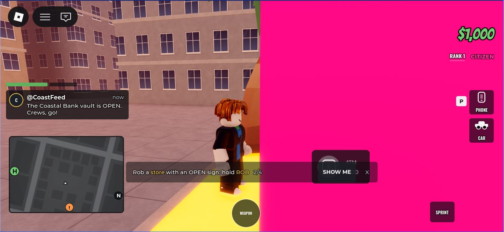
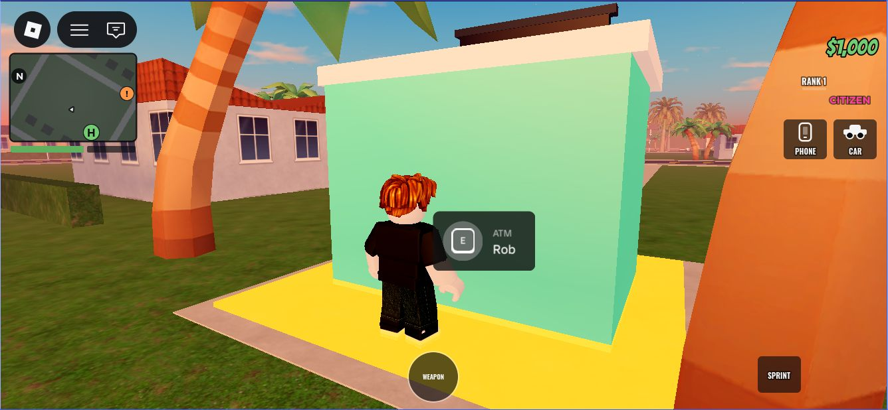

# 25. Rookie robbery + FirstRob funnel (Nov 8, 2026)

**Status: LIVE as v20** (published Nov 9 2026, 03:33:29 UTC = Nov 8, 8:33 PM MST, on the owner's "Yes, publish
it"). No server restart: running servers stay on v19 until they empty, and new servers get v20. **Not committed
yet** (git HEAD is still 1bb4dfb = v19).
Built, logic-tested and Studio-tested (Play Solo). The Studio test also found a pre-existing problem on phones
(the tutorial's guide line covered the ROB button at the store), fixed in section 3.

**How it was published:** the live place was opened in its own Studio window (`-task EditPlace`), and it loaded
version 19. A read-only check came first: all 6 target scripts' SyncSha and Source length equalled git HEAD's.
Then a DevSync clone on port 35182 synced only these 6 files (6 UPD, nothing else). The check after the sync
showed all 6 equal to the new files. Then File > Publish (Alt+P): "Publish succeeded … v20", and the games API
`updated` field said 2026-11-09T03:33:29Z.

## Why

After the first ad campaign ended (Nov 8), the onboarding funnel showed the same leak every day. Of the new
players who got into their car, about 2 in 3 left before their first robbery:

| Nov 8 (UTC) | Players | Step completion |
|---|---|---|
| 3. Tutorial_car | 65 | 79% |
| **4. Tutorial_rob** | **21** | **32%** |
| 5. Tutorial_bank | 17 | 81% |

Day 1 retention was 1.7% against a genre median of about 8%. Half of new players were gone within 3 minutes.

What the code showed: stores take turns being open (4 heist types at a time, 4–6 minutes each), and each
one shuts for 2–2.5 minutes after any robbery. The tutorial's GPS picked the nearest store that was open
when the step first came up. That could be across town, or a tier-2 store, and it could shut while the
newcomer was still driving there. They then arrived at a CLOSED sign with nothing to do. On top of that,
the ATM hold is 12 seconds, a long time to hold a button on a phone the first time.

## 1. Rookie robbery

A **rookie robber** is a citizen who hasn't banked a first bag yet and has nothing in their bag
(`Tutorial.CanRookieRob`). For them:

- Every **tier-1 site** (Glow Mart, Fuel Stop, all 5 ATMs) is **open**, whatever the rotation or cooldown says.
- The hold is **5 seconds at most** (it was 8 / 10 / 12).
- The tutorial's GPS goes to the **nearest** tier-1 site, never one across town or a tier-2 store.
- With a gun, they can hold up the clerk at a store that's shut for everyone else.
- **Nothing changes for anyone else.** If the store was shut, it stays shut for other players, and the rookie's
  robbery doesn't start its cooldown. If it was open, it's robbed as usual and cools down for everyone.
- The cops still come (the alarm, then the gentle rookie chase from doc 21), so the chase is still the payoff.
- Getting arrested empties the bag, so a rookie caught before banking gets the easy store again.
- Numbers: `Config/Tutorial.lua` → `Tutorial.RookieRob = { MaxTier = 1, Hold = 5 }`.

## 2. FirstRob funnel (the new tracking)

The onboarding funnel only says players vanish somewhere between "in the car" and "robbed". A second funnel,
**FirstRob** (Creator Hub → Analytics → Funnels, pick "FirstRob"), splits that gap. It runs once per server
visit for every player on the rob step:

| Step | Logged when |
|---|---|
| 1 InCar | the car step is done (or they rejoined already on the rob step) |
| 2 Moving | 80 studs from where they started the step |
| 3 NearStore | within 80 studs of a tier-1 Rob point |
| 4 OnFoot | within 20 studs of one, out of the car |
| 5 Holding | began a Rob hold, or a clerk hold-up |
| 6 Robbed | the rob step is done |

- **Leaving the game mid-step** logs the custom event **FirstRobQuit**. Field 1 holds the last step reached and
  the value holds the seconds spent on the step, so you can see both *where* and *how long* before they quit.
- The onboarding funnel is unchanged: the same step numbers, so before and after can be compared directly.
- Reading it: a big drop at 1→2 means they can't drive or don't know where to go. A drop at 3→4 means they don't
  get out of the car. A drop at 4→5 means they don't find the button. A drop at 5→6 means the hold is broken.

## 3. The guide line steps aside for the ROB button

Found in the first Studio test (below): on a phone, the tutorial's guide line ("Rob a store with an OPEN sign:
hold ROB") sits in the lower middle of the screen. That's exactly where a store's ROB button lands when you
stand beside it, and the line's SHOW ME button sat right on top of ROB.

Now the guide line hides **while a heist's ROB button (Rob or prep prompt) is on screen**, and comes back the
moment it goes. TutorialClient listens to Roblox's own ProximityPromptService.PromptShown / PromptHidden, so the
line never hides without a ROB button there to replace it. The button itself says what to do. During the hold,
the rob bar takes the same spot. The goal strip at the top of the screen isn't affected.

| Before | After |
|---|---|
|  |  |

## Files

| File | Change |
|---|---|
| `src/shared/Config/Tutorial.lua` | `Tutorial.RookieRob`, `Tutorial.CanRookieRob(player, tier)` |
| `src/server/Services/HeistService.lua` | rookie path on the Rob prompt and the clerk; `onRobbed(..., personal)` leaves a shut site as it was; notes rookie holds |
| `src/client/Controllers/HeistClient.lua` | OPEN sign, Rob prompt and 5 s hold for a rookie; clerk hold-up on a shut store |
| `src/client/Controllers/TutorialClient.lua` | GPS: the nearest tier-1 site counts as open for a rookie; the guide line hides while a ROB button is on screen |
| `src/server/Services/TutorialService.lua` | the FirstRob funnel and FirstRobQuit |
| `src/server/Services/Telemetry.lua` | `Telemetry.FunnelStep` (AnalyticsService:LogFunnelStepEvent) |
| `tools/logic-tests/rookierob.sh` | new: 49 checks |

## Tests

- **Compile:** all 6 changed scripts compile with luau-compile. The lint diff against the old versions shows only
  the usual Roblox-globals noise.
- **Logic test (`tools/logic-tests/rookierob.sh`): 49 PASS, 0 FAIL.** It runs the real HeistService, TutorialService,
  Config.Heists and Config.Tutorial against stand-in sites, prompts, a clerk and players on a virtual clock.
  - Who counts as a rookie: new, on the rob step, after losing the bag. Not: with a bag, after banking, a cop, tier 2.
  - A shut ATM: the rookie gets $900 in 5 s, a veteran gets nothing, and the site's cooldown is untouched.
  - Hold times: 4 s fails, 4.7 s pays, and a veteran still needs the full 8 s.
  - An open store robbed by a rookie cools down for everyone as usual.
  - Nothing in the rotation: the rookie still gets the first robbery, and it stays shut for everyone else.
  - A clerk hold-up at a shut store pays $1,500 (with the clerk bonus), and the store stays shut.
  - All six FirstRob steps are logged in order with one session id. Not OnFoot while seated.
  - FirstRobQuit logs the last step and the seconds spent. Rejoining starts a new run, and a finished guide is never tracked.
- **Other suites, re-run:** spin 74, crew 181, crewtip 30, robberbots 93, shop 13 and datastore 26, all PASS.
  (spin's 12 "building the Lucky Wheel" warnings are its usual ones; the count is the same with the old Tutorial.lua.)

## Studio test (Nov 8 2026, ~6:25 PM MST): PASS

- **Setup:** a scratch copy of NeonCoast.rbxl, opened from a file (SavesOff = true, so no DataStore and a fresh
  player at TutorialStep 0). The whole current tree was synced in with a DevSync2 clone on port 35181: HEAD
  1bb4dfb (live v19) plus these 6 files and two scratch-only test scripts (RookieTest, RookieTestClient).
  Nothing was saved to NeonCoast.rbxl, and the live place wasn't touched.
- **Driven by the test scripts** (one F5, results read from the Studio log):

| Check | Result |
|---|---|
| `AnalyticsService:LogFunnelStepEvent` exists (Telemetry's pcall would hide a wrong name) | yes, a function |
| All 7 tier-1 sites shut for everyone; only Club Nova and Sparkle & Co. open | the old GPS would have sent the newcomer to one of those tier-2 stores |
| GPS after the car step, from the downtown spawn | **ATM #1, the nearest tier-1 site (438 studs)** |
| Rookie at the shut ATM: prompt and sign | Enabled, **Hold 5**, sign **ATM OPEN** (green) |
| Robbery | $1,125 (900 + night bonus), Heat 1; the site's ReopenAt untouched, LastRobbedBy nil, still shut for others |
| FirstRob funnel | InCar, Moving, NearStore, OnFoot, Holding, Robbed, in order |
| Tutorial | TutorialStep 1 → 2 (the client reported the bag) |
| Bag in hand | prompt off, Hold 12, sign **ATM CLOSED** |
| Finished player (step 4) | prompt off, sign CLOSED |
| Bag lost before banking (step 2, empty bag) | OPEN again, robbed again for $1,125, the site still untouched |
| Errors / warnings from any game script during Play | none |

- **Not covered in Studio:** a two-client check (the logic test covers "the store stays shut for others"), and
  holding up a clerk at gunpoint (logic test only).

### Found: the guide line covers the ROB button (phones), fixed in section 3

With the touch layout (PreviewTouch), standing at the ATM, the ROB prompt sat under the tutorial's guide line, and
the **SHOW ME button sat right on top of it** (the "Before" picture in section 3). This is older than this
change, and a likely cause of an OnFoot → Holding drop in FirstRob.

### Re-test of the fix (Nov 8, ~7:10 PM MST, runs 2–4, touch layout from the start)

- **Run 2 used a first try at the fix:** hide the line within 14 studs of a Rob point (HeistClient.NearestRob).
  The test stood the player on a palm tree by ATM #5, just out of the button's 12-stud reach, and the line hid
  with no button showing. So the fix moved to Roblox's own PromptShown / PromptHidden (section 3), which can't
  get out of step with the button.
- **Run 4 (final):** standing on the ground 6 studs from ATM #5's Rob point.
  - The guide line **stayed visible** while Roblox hadn't shown the ROB button yet.
  - It **hid the moment the button showed** (client log: PromptShown RobPrompt → guide Visible=false).
  - At spawn, far from any store, the line showed as usual ("guide Visible=true").
  - There were no script errors.
- **Probably a Studio quirk, not a game bug:** in runs 2–4 Roblox held the ROB button back for most of the time at
  the ATM, so the test's scripted hold (InputHoldBegin) did nothing. The likeliest cause is window focus: the
  owner was using Firefox and the Studio window kept losing focus. Unconfirmed; run 1, with Studio left in
  front, showed the button and robbed fine. The robbery itself (server, prompt, 5 s
  hold) passed in run 1 and in the logic test, and TutorialClient doesn't take part in it.

## Studio checklist (before publishing)

Play with **one new player**: reset the save, or use a test account whose tutorial isn't done.

1. Pick Citizen, get in the car. The GPS should go to the **nearest ATM or store** (from the downtown spawn, by
   CityGen's layout, ATM #1 about 440 studs south-west), not across town.
2. Drive there. The sign should read **OPEN** in green even if the rotation has that store shut. Check with a
   second client: for them it should still say CLOSED.
3. Get out. The **Rob** prompt shows, and the hold bar fills in **5 seconds**.
4. Paid: the result stamp, the bag, the GPS to the Hideout, and the cops come (the gentle rookie chase).
5. Second client, a finished player at the same store: still CLOSED, no prompt, and no cooldown started by the rookie.
6. Rob again with the bag still full: the store goes back to normal for the rookie (CLOSED if it's shut).
7. Get arrested before banking, then respawn: the easy store works again.
8. With a gun (the wheel's free gun): aim at a Glow Mart / Fuel Stop clerk while that store is shut. They should
   put their hands up and fill the bag.
9. Output window: no new errors or warnings from HeistService, HeistClient, TutorialService or TutorialClient.
10. **Phone emulator (iPhone size):** the prompt is tappable, the 5 s bar shows, and the OPEN sign is readable.

After publishing, the FirstRob funnel needs a day or two of new players. With the ads off, that means a small
ad test (~$10/day) once this is live.
